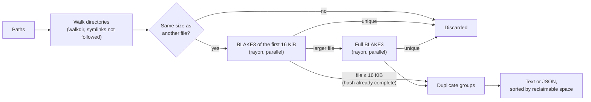

# dupfind

[](https://github.com/mhxtecnologia/dupfind/actions/workflows/ci.yml)
[](https://github.com/mhxtecnologia/dupfind/releases/latest)
[](LICENSE)

A fast, cross-platform command-line tool that finds duplicate files.

It walks the given directories, discards every file whose size is unique, compares the
BLAKE3 hash of the first 16 KiB, and only then hashes whole files — in parallel on all
CPU cores. Most of the disk is never read.

```console
$ dupfind ~/Pictures --min-size 100K
3 copies of 4.2 MiB (8.4 MiB reclaimable)  blake3:9f2c4e1a7b3d0c55
  /home/me/Pictures/2024/trip/IMG_0412.jpg
  /home/me/Pictures/backup/IMG_0412.jpg
  /home/me/Pictures/phone-export/IMG_0412 (1).jpg

2 copies of 1.1 MiB (1.1 MiB reclaimable)  blake3:04aa61d3e8f97b20
  /home/me/Pictures/logo-final.png
  /home/me/Pictures/logo-final-v2.png

Scanned 18342 files: 2 duplicate groups, 3 redundant copies, 9.5 MiB reclaimable.
```

## How it works



Each stage only receives the files that still collide in the previous one, so the cost
follows the number of *likely* duplicates, not the size of the disk.

## Technical decisions

| Decision | Why |
|---|---|
| **Three stages: size → 16 KiB prefix → full hash** | Size comes from metadata, so unique sizes cost no I/O. Large files that differ in their first bytes (most media and archives) stop after 16 KiB. Only real candidates are read in full. |
| **BLAKE3** | Cryptographic strength (no practical collisions, unlike CRC or xxHash) at several GB/s per core. `update_reader` streams in 64 KiB blocks, so memory stays constant for any file size. |
| **rayon for parallel hashing** | Work-stealing over the list of files keeps every core busy even when file sizes are very uneven. `--threads` caps it for spinning disks or shared machines. |
| **Symlinks are not followed** | Avoids directory cycles and reporting the same file twice through a link. |
| **Overlapping roots are collapsed** | `dupfind . ./src` scans `src` once; otherwise every file in it would be reported as a duplicate of itself. Roots are compared by canonical path, but output keeps the paths as typed. |
| **Unreadable files are warnings, not failures** | One file without permission should not abort a scan of a whole disk. Warnings go to stderr (and to `errors` in JSON); `--quiet` hides them. |
| **File names are untrusted input** | In text output and warnings, control characters, bidi overrides and invisible format characters (zero-width spaces, BOM, line separators) in a path are printed as `\u{..}`, so a crafted name cannot inject ANSI escape sequences into your terminal or fake extra lines. JSON escapes them natively. |
| **Deterministic output** | Groups are sorted by reclaimable space, paths alphabetically, so the output is diff-friendly and testable. |
| **Read-only by design** | dupfind never deletes or links anything. It reports; you decide. |
| **Static release binaries** | Linux builds use musl (no glibc version requirements) and Windows builds link the C runtime statically (no Visual C++ Redistributable needed). |

## Installation

Download a pre-built binary for Linux (x86_64, ARM64), Windows (x86_64) or macOS (Apple
Silicon, Intel) from the [latest release](https://github.com/mhxtecnologia/dupfind/releases/latest).
Every archive ships with a `.sha256` checksum.

Or build from source with a recent stable Rust toolchain:

```bash
cargo install --git https://github.com/mhxtecnologia/dupfind
```

## Usage

Run it from source with one command:

```bash
cargo run --release -- ~/Downloads
```

```text
Usage: dupfind [OPTIONS] [PATHS]...

Arguments:
  [PATHS]...  Directories or files to scan [default: .]

Options:
  -s, --min-size <SIZE>    Ignore files smaller than SIZE (e.g. 512, 10K, 1.5M; binary units) [default: 1]
  -H, --ignore-hidden      Skip hidden files and directories (dot-files; also the hidden attribute on Windows)
  -f, --format <FORMAT>    Output format [default: text] [possible values: text, json]
  -j, --threads <THREADS>  Hashing threads [default: number of logical CPUs]
  -q, --quiet              Do not print warnings about unreadable files
  -h, --help               Print help
  -V, --version            Print version
```

Empty files are skipped by default (`--min-size 1`); pass `--min-size 0` to include them.

### JSON output

`--format json` prints a stable structure for scripts:

```json
{
  "summary": {
    "scanned_files": 3,
    "duplicate_groups": 1,
    "redundant_files": 1,
    "reclaimable_bytes": 5,
    "errors": 0
  },
  "groups": [
    {
      "size": 5,
      "reclaimable_bytes": 5,
      "hash": "ea8f163db38682925e4491c5e58d4bb3506ef8c14eb78a86e908c5624a67200f",
      "paths": ["./a/one.txt", "./b/two.txt"]
    }
  ],
  "errors": []
}
```

For example, list every redundant copy (all but the first path of each group) with `jq`:

```bash
dupfind --format json ~/Music | jq -r '.groups[].paths[1:][]'
```

### Exit codes

| Code | Meaning |
|---|---|
| `0` | Scan finished (with or without duplicates) |
| `2` | Usage error, such as an invalid option or a path that does not exist |

## Tests

```bash
cargo test
```

- **Unit tests** — size parsing and formatting, root de-duplication, report formatting.
- **Integration tests** (`tests/find.rs`) — real file trees in temporary directories
  ([tempfile](https://crates.io/crates/tempfile)): nested directories, files that differ only
  after the 16 KiB prefix, empty files, `--min-size`, hidden files, overlapping roots and
  sort order.
- **End-to-end tests** (`tests/cli.rs`) — run the compiled binary and check text output,
  JSON output, exit codes and argument validation.

CI runs `cargo fmt --check`, `cargo clippy -D warnings` and the full test suite on Linux,
Windows and macOS for every push. Pushing a `v*.*.*` tag builds and publishes the release
binaries.

## Project layout

```text
src/
  main.rs     CLI: argument parsing (clap), exit codes, output
  lib.rs      find_duplicates() and the Report/Summary types
  scan.rs     recursive walk, filters, overlapping roots
  dedup.rs    size → prefix hash → full hash pipeline (rayon + BLAKE3)
  report.rs   text and JSON formatting
  size.rs     "10K" / "1.5 MiB" parsing and formatting
tests/
  find.rs     library integration tests
  cli.rs      end-to-end tests of the binary
```

## License

[MIT](LICENSE) © Matheus Henrique Takeuchi
